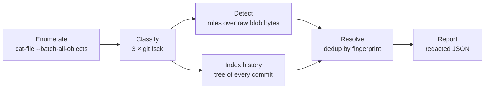

# git-secret-recovery

**Find what Git forgot to forget.**

[](https://github.com/mehdi-lakhzouri/GitGuardian/actions/workflows/ci.yml)


An offline, read-only forensics tool that recovers credentials from **every object** in a
local Git repository, including commits that no branch, log or stash shows anymore. It
reports each distinct secret's type, file path, line, commit, author, date and
reachability as machine-parsable JSON, without ever revealing the secret itself.

> Built as the technical exercise for the **GitGuardian Cybersecurity Researcher
> Internship (2027)**. The companion research note on OpenAI API keys is in
> [`docs/credential_research.md`](docs/credential_research.md).

## Contents

- [Why this tool](#why-this-tool)
- [Quick start](#quick-start)
- [Usage](#usage)
- [Output](#output)
- [How it works](#how-it-works)
- [Detection rules](#detection-rules)
- [Demonstration: five hiding scenarios](#demonstration-five-hiding-scenarios)
- [Project structure](#project-structure)
- [Security model](#security-model)
- [Testing](#testing)
- [Limitations](#limitations)

## Why this tool

Deleting a secret from a Git repository rarely deletes it. Git stores every version of
every file as an immutable **object**. `git rm`, `commit --amend`, `rebase`,
`branch -D` and `stash drop` only remove the *references* to those objects. The
objects stay in `.git/objects` until garbage collection, which by default waits weeks.

`git log --all` only walks what is still referenced, so it misses these objects.
`git-secret-recovery` enumerates the object database itself:

| Capability | Description |
| --- | --- |
| **Complete coverage** | Every loose and packed object: reachable, reflog-only and unreachable (dangling) |
| **Full attribution** | Every historical occurrence of a secret, with path, line, commit, author, date and reachability |
| **Deduplication** | One finding per distinct secret (SHA-256 fingerprint), however many commits carried it |
| **Safe by design** | Offline, never writes to the scanned repository, never outputs a raw secret |
| **Pipeline-friendly** | JSON on stdout, diagnostics on stderr, meaningful exit codes |
| **Zero runtime dependencies** | Python standard library and the Git CLI only |

## Quick start

Requirements: **Python 3.11+**, **Git**, and [uv](https://docs.astral.sh/uv/).

```sh
git clone https://github.com/mehdi-lakhzouri/GitGuardian.git
cd GitGuardian
uv sync                                                    # create the environment

uv run python tests/fixtures/generate_repo.py ../demo-repo # build a repo with hidden fake secrets
uv run git-secret-recovery scan ../demo-repo               # recover them
```

```text
git-secret-recovery: scanned 35 objects (9 blobs) in 1.175s: 7 secrets, 8 occurrences
```

To install the command globally instead, run `uv tool install .`.

## Usage

```sh
git-secret-recovery scan <repository> [--output FILE]
python -m git_secret_recovery scan <repository> [--output FILE]
```

| Argument | Description |
| --- | --- |
| `repository` | Path to a local Git repository (work tree or bare) |
| `-o`, `--output FILE` | Write the JSON report to `FILE` instead of stdout. Refused if `FILE` is inside the scanned repository. |
| `--version` | Print the version and exit |

| Exit code | Meaning |
| --- | --- |
| `0` | Scan completed, no secret found |
| `1` | Scan completed, **secrets found** (fails a CI step) |
| `2` | Usage error, invalid or malformed repository, or the report could not be written |

stdout carries only the JSON document, so it can be piped straight into `jq` or another
tool. Every diagnostic and error goes to stderr.

## Output

A trimmed report for the demo repository. It shows one finding; the full report has
seven.

```json
{
  "schema_version": 1,
  "tool": { "name": "git-secret-recovery", "version": "0.1.0" },
  "repository": { "path": "/tmp/demo-repo", "head": "3d192a3a0ff3611b7505ad0ba078efad489da04a" },
  "scan": { "started_at": "2026-10-26T21:35:01.508449+00:00", "duration_seconds": 1.175 },
  "summary": {
    "objects": 35,
    "objects_by_type": { "blob": 9, "commit": 11, "tree": 15 },
    "objects_by_reachability": { "reachable": 17, "reflog_only": 14, "unreachable": 4 },
    "blobs_scanned": 9,
    "binary_blobs": 1,
    "findings": 7,
    "occurrences": 8,
    "findings_by_type": {
      "aws_access_key_id": 2, "aws_secret_access_key": 2, "github_classic_pat": 2, "private_key": 1
    },
    "occurrences_by_reachability": { "reachable": 2, "reflog_only": 5, "unreachable": 1 }
  },
  "findings": [
    {
      "type": "private_key",
      "fingerprint_sha256": "1653950f3097c18f3e2b108554f9e77eeb0fe4c26a69ad8ca1b10163328d19d9",
      "redacted": "----…[886 chars]",
      "occurrences": 2,
      "locations": [
        {
          "blob_sha": "2262d1398ab864d304b73abb0ff389881783da90",
          "path": "deploy/id_rsa",
          "line": 1,
          "start_byte": 0,
          "end_byte": 886,
          "commit_sha": "5921d3e36d7d35aa9212dcefbc636c90dbcf32f2",
          "author_name": "Dave Deployer",
          "author_email": "dave.deployer@example.com",
          "date": "2026-01-01T14:00:00+00:00",
          "reachability": "reflog_only"
        },
        {
          "blob_sha": "2262d1398ab864d304b73abb0ff389881783da90",
          "path": "deploy/id_rsa",
          "line": 1,
          "start_byte": 0,
          "end_byte": 886,
          "commit_sha": "2612ffe90d6825bd2d17eca28efe198637a46223",
          "author_name": "Dave Deployer",
          "author_email": "dave.deployer@example.com",
          "date": "2026-01-01T16:00:00+00:00",
          "reachability": "reflog_only"
        }
      ]
    }
  ]
}
```

### Location fields

Each finding lists every place the secret appeared, oldest first. Every key is always
present; unknown values are `null`.

| Field | Type | `null` when |
| --- | --- | --- |
| `blob_sha` | string | Never |
| `path` | string | The blob was never part of a committed tree (e.g. staged, then unstaged) |
| `line`, `start_byte`, `end_byte` | integer | Never. Byte offsets point at the exact secret in the blob |
| `commit_sha` | string | No commit contains the blob |
| `author_name`, `author_email`, `date` | string (ISO 8601) | No commit, or the commit has no parseable author |
| `reachability` | `reachable` \| `reflog_only` \| `unreachable` | Never |

**No raw secret is ever written.** A finding carries only a SHA-256 fingerprint and a
4-character prefix (`ghp_…[40 chars]`). Paths, author fields and error messages are
also passed through the detectors, in case a secret was used as a file name or a Git
identity. The JSON is ASCII-only, so it is valid on any console encoding.

## How it works



1. **Enumerate.** `git cat-file --batch-all-objects` lists every loose and packed object
   once, whether or not anything references it.
2. **Classify.** Three `git fsck --connectivity-only` passes sort objects into the
   reachability states below. Each object is also marked dangling or not (unreachable,
   and referenced by no other object).
3. **Detect.** Each blob's raw bytes go through every rule, read in batches of 256 via
   `git cat-file --batch`.
4. **Index history.** The tree of *every* commit object is walked: amended, rebased,
   deleted-branch and stash commits included. This maps each blob to its (path, commit)
   pairs.
5. **Resolve.** Matches are grouped by `(type, SHA-256)` into findings, keeping every
   occurrence.
6. **Report.** The result is serialized to versioned JSON, with free text redacted.

### Reachability model

| State | Still referenced by | Typical cause |
| --- | --- | --- |
| `reachable` | A branch, tag, stash or the index | The file was deleted, but an older commit still has it |
| `reflog_only` | Only a reflog entry | `commit --amend`, `rebase`, `branch -D` |
| `unreachable` | Nothing; survives until `git gc` | `stash drop`, or anything after its reflog expired |

Reachability is reported **per occurrence** and comes from the commit, not the blob:
the same blob can sit in both a reachable commit and an orphaned one.

### Design decisions

- **Object enumeration, not history walking.** This is the only way to see dangling
  objects such as a dropped stash.
- **Rules work on bytes, not text.** Offsets are exact, binary blobs need no decoding,
  and invalid UTF-8 cannot break a scan.
- **Pure, independent rules.** Each rule is a single `detect(bytes)` function. Adding a
  credential type means adding one module.
- **Immutable data model.** Every record is a frozen dataclass, and the raw secret is
  excluded from `repr` so it cannot leak through logs or tracebacks.

## Detection rules

| Rule | Detects | False-positive guard |
| --- | --- | --- |
| `aws` | Access key IDs `AKIA…` / `ASIA…` (20 chars) | Upper-case alphabet, word boundaries |
| `aws` | Secret access keys (40 chars) | Must be assigned to a `secret_access_key`-style name **and** be identifiably AWS: an `aws` prefix, or an access key ID in the same blob |
| `github` | `ghp_` `gho_` `ghu_` `ghs_` `ghr_` + 36 chars; `github_pat_` + 22 + `_` + 59 | Exact lengths, word boundaries; typed per prefix |
| `private_key` | PEM / OpenSSH / PGP `PRIVATE KEY` blocks | BEGIN and END labels must match; the body (minus armor headers) must be valid base64 of at least 32 bytes. Handles CRLF line endings and keys escaped as `\n` inside JSON |

## Demonstration: five hiding scenarios

[`tests/fixtures/generate_repo.py`](tests/fixtures/generate_repo.py) builds a
reproducible repository. Identities, dates and config are pinned, and the global Git
config is ignored. It hides **fake** credentials in five ways:

| Scenario | How the secret was hidden | Secret | Found at | Occurrences | Reachability |
| --- | --- | --- | --- | --- | --- |
| File deletion | `git rm` in a later commit | AWS key ID + secret | `config/aws_credentials:2-3` | 1 | `reachable` |
| Commit amend | `commit --amend` replaced the commit | GitHub PAT | `.env:1` | 1 | `reflog_only` |
| Rebase | `rebase --onto` dropped the commit | Private key | `deploy/id_rsa:1` | 2 | `reflog_only` |
| Branch deletion | `branch -D` on an unmerged branch | AWS key ID + secret | `scripts/backup.sh:2-3` | 1 | `reflog_only` |
| Stash drop | `stash push` then `stash drop` | GitHub PAT | `README.md:3` | 1 | `unreachable` |

After `git reflog expire --expire=now --all`, every rewritten secret becomes
`unreachable` and is **still recovered**. Only `git gc --prune=now` destroys them.

The fixture contains only AWS's published `…EXAMPLE` keys, `ghp_FAKE…` tokens, and a
PEM envelope around deterministic random bytes. None of them is a valid credential.

## Project structure

```text
src/git_secret_recovery/
├── cli.py                    argparse entry point: streams, exit codes, output guard
├── __main__.py               python -m git_secret_recovery
├── core/
│   ├── models.py             frozen dataclasses (GitObject, Commit, Finding, ScanResult…)
│   └── scanner.py            scan_repository(): the end-to-end pipeline
├── git/                      read-only Git forensics
│   ├── repository.py         validation and a shell-free, read-only run_git()
│   ├── objects.py            enumerate, classify and read objects; parse commits
│   └── history.py            refs, reflogs, blob → path → commit index
├── detection/
│   ├── engine.py             scan_blob(bytes): byte offsets and line numbers
│   └── rules/                aws.py · github.py · private_key.py
├── attribution/
│   └── resolver.py           deduplication and historical attribution
└── reporting/
    ├── serializer.py         ScanResult → JSON (schema_version 1)
    └── redaction.py          mask secrets in any free text
tests/
├── fixtures/                 fake-secret repository generator
├── unit/                     rules, engine, resolver, serializer, redaction, CLI
└── integration/              end-to-end scans of generated repositories
docs/
└── credential_research.md    OpenAI API keys: detection, safe validation, ownership
```

## Security model

| Property | How it is enforced |
| --- | --- |
| **Offline** | No network access. Credentials are never validated against a service. |
| **Read-only** | Only read-only plumbing commands are called. `GIT_OPTIONAL_LOCKS=0`, `gc.auto=0`, `maintenance.auto=false` and `core.fsmonitor=false` stop Git from writing to the repository or running code from its config. Tests hash every file before and after a scan. |
| **No command injection** | Git always runs from an argument list, never through a shell. |
| **No disclosure** | Raw values live only in memory. Reports, stderr and error messages carry fingerprints and redacted prefixes only. |
| **No side effects** | A report path inside the scanned repository is refused. |

## Testing

```sh
uv run pytest                                          # 139 tests
uv run ruff format --check . && uv run ruff check .    # formatting and lint
```

| Suite | Tests | Covers |
| --- | --- | --- |
| Unit | 90 | Each detection rule (including false-positive lookalikes), engine offsets and binary input, deduplication, missing metadata, JSON schema, redaction, CLI arguments and errors |
| Integration | 49 | All five hiding scenarios, reflog expiry, packed vs loose objects, read-only guarantee, end-to-end CLI in a subprocess (stdout, stderr, exit codes) |

CI runs formatting, lint and the full suite on **Ubuntu and Windows** for every pull
request ([workflow](.github/workflows/ci.yml)).

## Limitations

### Detection

- **No validity check.** By design, no credential is checked online. GitHub's offline
  token checksum is not verified either, since the fixture tokens would fail it.
- **No allowlist.** AWS's documented `…EXAMPLE` keys are reported like real keys,
  because the fixture relies on them.
- **AWS secret keys need context.** A secret key with no `aws` in its name, in a blob
  with no access key ID, is not reported.
- **Not detected:** truncated private keys (no END line), binary key formats (DER,
  PKCS#12), compressed or encoded content, and secrets in commit messages or tag
  annotations.

### Git forensics

- **Garbage collection is final.** Objects pruned by `git gc` cannot be recovered from
  the local object store.
- **Never-committed data.** A staged-then-unstaged file is recovered, but it has no path,
  commit, author or date. Changes that were never staged did not become objects.
- **Local scope.** History that exists only on a remote, a fork or a hosting provider's
  PR refs is not visible locally. Shallow and partial clones may lack objects; missing
  objects are logged and skipped.
- **Scale.** `fsck` runs three times and `ls-tree` runs once per distinct root tree.
  This is fine for typical repositories but slow on very large monorepos.
- **Other cases:** commit text is decoded as UTF-8 (the legacy `encoding` header is
  ignored), submodule contents are skipped, and Git's `safe.directory` ownership check
  is respected rather than bypassed.
